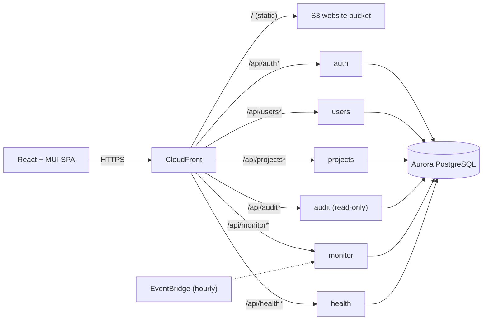

# Project Hub

A project-management web app for **Admins, Managers and Employees**: create and staff projects, plan milestones with dependencies, keep labour costs inside budgets, never overbook anyone beyond 40 hours a week, and keep a tamper-proof audit trail of everything that happens.

Built for the Citi Coding Workshop (Full Stack track) on the required stack: **React + Material UI + React Responsive → Python AWS Lambdas → PostgreSQL**, deployed to AWS with Terraform and shell scripts.

- **Live (AWS):** https://d37hjhs1g613o6.cloudfront.net
- **Testing:** see [TESTING.md](./TESTING.md) for commands, results, coverage and known gaps
- **Workshop guides:** [docs/](./docs/README.md)

---

## Contents

1. [What it does](#what-it-does)
2. [Business rules](#business-rules)
3. [Architecture](#architecture)
4. [Running it locally](#running-it-locally)
5. [Deploying to AWS](#deploying-to-aws)
6. [Repository layout](#repository-layout)
7. [Design decisions and trade-offs](#design-decisions-and-trade-offs)
8. [Known limitations](#known-limitations)

---

## What it does

| Role | Can do |
|---|---|
| **Admin** | Create every account. **Employee IDs are generated from the person's initials plus 4 random characters** (e.g. Eli Employee → `EE3H9W`; letters and digits without look-alikes like 0/O and 1/I/L) and never change, even if the person is renamed; the 6-character password is generated and shown once, and **the person must choose their own password the first time they sign in** (the same applies after an admin resets a password). Create, edit, archive and reactivate projects and assign their manager. Approve or reject managers' project requests (approving creates the project, optionally with adjusted budget/dates/manager). See the organisation dashboard, the full **Audit log**, and each project's history. Run the budget check. |
| **Manager** | See and run the projects they manage: schedule, budget, status, **milestones with dependencies**, and **staffing** (hours per week). Staff any employee; staffing someone else's report sends the hours to that employee's manager for **approval**. Approve or reject hours requested for their own reports. Request new projects. Edit their direct reports' basic details. See a **scoped Audit log**: their own activity and their direct reports' (never other managers' or admins'). Dashboard with their team's load this week. |
| **Employee** | See the projects they're assigned to, their hours (and hours awaiting approval), the team and milestones - never budgets or costs. Update their own name and email. Dashboard showing their week against 40 hours and upcoming milestones. |

Everything is responsive: a permanent sidebar on desktop, a slide-out menu and simplified tables on phones.

## Business rules

These are enforced **on the server** (the UI previews them, but the API is the gatekeeper):

- **40-hour week:** an employee's hours across current projects can never exceed 40 in any week. The check uses their *busiest overlapping period* - 30 h in January plus 30 h in March doesn't block 10 h on a January-March project.
- **Budget is a hard limit:** projected labour cost = Σ hours/week × working weeks × (annual salary ÷ 2080). Adding people, raising hours, cutting the budget or extending dates past it are refused (409 with the exact overage). Reducing hours or removing people is always allowed, so an over-budget project can be fixed.
- **Pay rises are never blocked** by a project budget; affected projects are flagged over budget and named in the audit entry.
- **Cross-team approval:** hours for someone else's report (requested by another manager *or* an admin) wait for that employee's own manager. Pending hours are *reserved* against both rules, so approving can never fail. Reductions apply immediately.
- **Milestones:** start on/after the project start; can't start before their dependencies are due; can't be worked on until dependencies are completed; no circular dependencies; can't be deleted while others depend on them. A due date after the predicted end is allowed but flagged.
- **Nothing is deleted:** projects are archived (read-only, hidden by default) and users deactivated. An employee still on current projects can't be deactivated, and a manager with reports or projects can't be demoted until they're reassigned. The last admin can't be removed.
- **Temporary passwords are single-use in practice:** until a user with an admin-issued password chooses their own (≥ 8 characters, a letter and a number, different from the temporary one), every API call except the change-password flow is refused (403 `password_change_required`), so the step can't be bypassed. Anyone can change their password later from My profile.
- **Audit log:** every change, sign-in, sign-out and *denied attempt* is recorded with time, who (ID, name, role), what, and a field-by-field before/after. It's written in the **same transaction** as the change and the database **rejects UPDATE/DELETE/TRUNCATE** on it. Salaries are redacted; passwords never logged. Admins see everything; managers see only their own entries, their current direct reports' and failed sign-ins against those accounts (enforced in the query, not just hidden in the UI).
- **Insights** (rule-based, not AI): over budget, budget ≥ 90% committed, overdue milestones, past predicted end with work open, milestones slipping past the end, active with no team, no milestones, staffing awaiting approval.

## Architecture



- **Six Lambda services**, one per domain, each a folder under `backend/services/` containing only its own code (Terraform discovers them automatically). The `projects` service is organised as `queries.py`, `staffing.py` and a `routes/` package (projects, assignments, approvals, milestones, requests, dashboard) so related writes share one transaction.
- **Shared core library** `backend/shared/pm_core` (router, error format, validation, JWT/RBAC, audit, DB/migrations, budget, capacity, insights, employee IDs) and **one `backend/requirements.txt`** for all services. [`bin/build-backend.sh`](./bin/build-backend.sh) assembles each Lambda's package in `backend/.build/<service>/` (code + shared library + libraries, installed once and hard-linked), which Terraform deploys and LocalStack runs.
- **PostgreSQL only** (Aurora PostgreSQL Serverless v2 on AWS, PostgreSQL locally). Schema migrations run automatically from the Lambdas on first use (Aurora isn't reachable from the workshop VDI), guarded by an advisory lock. The template's MongoDB is not used.
- **Consistent API:** JSON everywhere, errors as `{"error": {"code", "message", "details"}}`, status codes 200/201/204/400/401/403/404/405/409/429/500, `PATCH` and `PUT` for updates, filtering and pagination via query parameters.
- **Frontend:** organised by feature (`auth/`, `pages/`, `components/<feature>/`, `services/`, `hooks/`); one API client with transparent token refresh; a central permissions map that hides what a role can't do; lazily loaded pages; 30 s polling for near-real-time data.

## Running it locally

**Prerequisites:** the workshop VDI (Docker, LocalStack Pro with `LOCALSTACK_AUTH_TOKEN`, PostgreSQL, Terraform, Node 22, Python 3.13), as checked by [docs/validation.md](./docs/validation.md).

```sh
./bin/start-dev.sh            # Postgres, LocalStack, deploys all Lambdas, proxy :3001, React :3000
```

Open **http://localhost:3000** and sign in with a demo account (local only - see below for AWS):

| Role | Employee ID | Password |
|---|---|---|
| Admin | `AA7K2P` | `Admin1` |
| Manager | `MM4R8T` | `Mngr01` |
| Employee | `EE3H9W` | `Empl01` |

After editing backend code, run `./bin/build-backend.sh` (about a second); LocalStack runs the built packages directly, so changes are live without a redeploy.

**Checks** (details in [TESTING.md](./TESTING.md)):

```sh
cd backend && python3 -m venv .venv && .venv/bin/pip install -r requirements-dev.txt
.venv/bin/pytest                      # 335 unit + integration tests (uses a separate pm_test database)
.venv/bin/ruff check . && .venv/bin/ruff format --check .
cd ../frontend && npm test            # 147 component/service tests (Vitest + React Testing Library)
npm run lint && npm run e2e           # ESLint; 18 Playwright journeys + 5 axe accessibility scans
cd .. && ./bin/smoke-test.sh          # 62 live API checks (local by default, or pass a URL)
```

## Deploying to AWS

```sh
./bin/deploy-backend.sh aws           # Terraform: Lambdas, Aurora, S3, CloudFront (+ migrations on first request)
./bin/deploy-frontend.sh aws          # builds with the CloudFront URL, uploads to S3, invalidates the cache
./bin/smoke-test.sh https://<cloudfront-domain>    # with SMOKE_*_PASSWORD set (see below)
./bin/e2e-live.sh [--ui | --headed]   # Playwright journeys against the live site (reads the demo passwords itself)
```

**Demo accounts on AWS use random passwords** (the repository is public, so the documented local passwords are never used in the cloud). They are logged once, privately, when the database is first seeded:

```sh
source ENVIRONMENT.config && aws logs tail /aws/lambda/coding-workshop-health-<app-id> --since 24h | grep "one-time passwords"
```

Sign in as `AA7K2P` with that password and reset the others from **Users**.

> Deployments seeded before the initials-based ID format list the demo passwords under the old IDs (`ADM001`, `MGR001`, `EMP001`). Migration 5 converted those accounts to `AA7K2P`, `MM4R8T` and `EE3H9W` with the same passwords, and logged the old → new mapping for any other users (`grep "Employee IDs converted"` in the same log).

## Repository layout

```
backend/
  requirements.txt     runtime libraries for every service (one list)
  shared/pm_core/      shared library
  services/            one Lambda each: auth/ users/ audit/ monitor/ health/ projects/
    projects/          function.py, queries.py, staffing.py, routes/
  tests/unit/          core logic (validation, budget, capacity, auth, audit, schema...)
  tests/services/      each service end to end against PostgreSQL
  .build/              generated Lambda packages (gitignored)
frontend/
  src/               React app (auth/, pages/, components/<feature>/, services/, hooks/, utils/)
  e2e/               Playwright journeys
infra/               Terraform (template) + cloudfront.tf SPA routing + scheduler.tf
bin/                 dev/deploy scripts, build-backend.sh, smoke-test.sh, e2e-live.sh
loadtest/            Artillery load test
docs/                workshop guides (unchanged)
```

## Design decisions and trade-offs

| Decision | Why | Trade-off |
|---|---|---|
| One Lambda per domain + a shared library and one requirements list, assembled by a build step | Independent deploys and failure isolation, matching the template; no copy-pasted code or duplicated dependency lists; source folders contain only source | A build step (`build-backend.sh`, run automatically by the dev and deploy scripts) |
| Requests, approvals, staffing and milestones inside the `projects` service | Approving a request *creates* a project; staffing touches budgets - each must be one transaction | A larger service, split into route modules |
| Roles re-checked against the database on every request | Role changes and deactivations apply immediately, not when a 15-minute token expires | One extra indexed query per request |
| Row locks (`FOR NO KEY UPDATE`) for the 40-hour and budget rules | Two simultaneous requests can't both squeeze into the last free hours or dollars (a test proves exactly one wins) | Brief serialisation on the same project/employee |
| Pending hours are reserved | Approvals can never fail; nobody double-books while a request waits | Reserved capacity until the manager decides |
| Tokens in `localStorage` | Simple; survives reloads; frontend and API are on different origins locally | Exposed to XSS if one existed - mitigated by 15-min tokens and server-side role checks |
| 6-character passwords (per brief) | Requirement | Mitigated by PBKDF2 (120k rounds), lockout after 5 failures in 15 min, identical errors for unknown IDs |
| Polling instead of WebSockets | Lambda function URLs can't hold persistent connections | Up to 30 s latency for others' changes |
| CloudFront Function for SPA routes | Deep links work; API 404s stay real 404s (the template's global 404→index.html rewrite broke both) | One small infra addition |
| Vitest instead of Jest | Vite-native, Jest-compatible API (`describe/it/expect`, mocks); React Testing Library as the rubric asks | - |

## Known limitations

- **Hourly budget monitor on AWS:** the workshop's participant role is denied EventBridge and EventBridge Scheduler (`AccessDenied` on `events:ListRules` and `scheduler:ListSchedules`), so the hourly schedule is enabled on LocalStack only. On AWS the same check runs on demand (admin dashboard → *Run budget check now*); set `TF_VAR_aws_monitor_schedule_enabled=true` in an account that allows it.
- **Aurora Serverless v2 auto-pauses** after idle time; the first request afterwards can take ~15-20 s while it resumes (the connection timeout allows for this).
- Not a PWA (installable/offline) - deprioritised for time.
- Holidays aren't modelled in working-day calculations (Mon-Fri, 8 h/day).

---

## License and credits

Licensed under the MIT-0 License - see [LICENSE](./LICENSE). Built on the Citi Coding Workshop template; see [CONTRIBUTING](./CONTRIBUTING.md) and the [workshop guides](./docs/README.md). Template authors: Colin Heilman, Eugene Istrati, Isaiah Cornelius Smith, Juan Arevalo, Michael Annucci.
